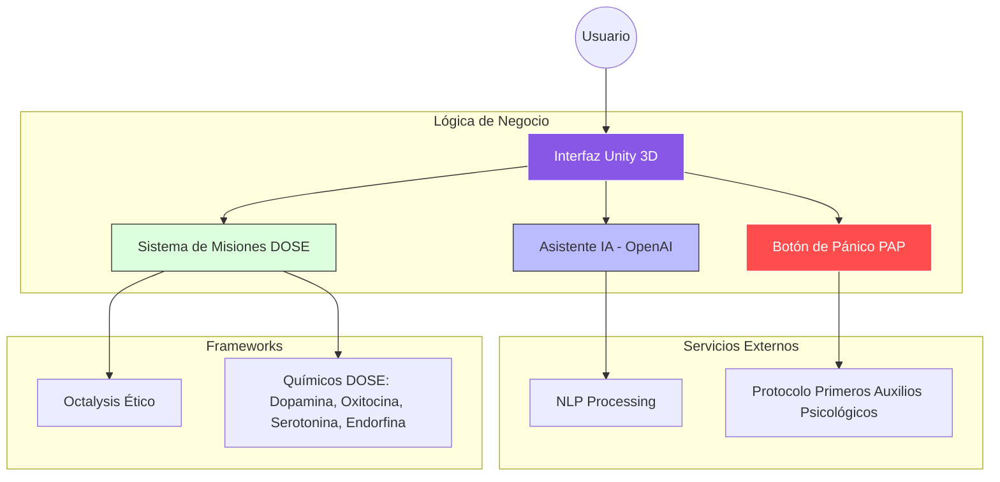

# 🐾 Mishi-HealthTech: Ingeniería de Software & Bienestar Humano

  
  
  

## 📖 Resumen Ejecutivo
**Mishi** es un ecosistema digital inmersivo diseñado para mitigar el deterioro de la salud mental. A través de **Inteligencia Artificial (NLP)** y un sistema de **Gamificación Ética**, el asistente virtual guía al usuario en la gestión del estrés sin generar dependencia. 

El proyecto destaca por su validación en entornos reales (Networking Espacio Blanco), donde se comprobó la eficacia de las micro-misiones en la segregación de químicos naturales de la felicidad.

---

## 🔗 Evidencia y Documentación

  
  &nbsp;&nbsp;
  
  &nbsp;&nbsp;
  

---
## ⚙️ Arquitectura Funcional del Ecosistema

Este diagrama detalla cómo interactúan los módulos de IA, el sistema de misiones y los protocolos de emergencia:

---

## 🔍 Inmersión en las Funcionalidades

<b>🧠 IA & Diálogo Dinámico (OpenAI)</b>

 

Mishi utiliza procesamiento de lenguaje natural (**NLP**) para actuar como un compañero de escucha activa. El asistente está diseñado para detectar estados de ánimo y ofrecer respuestas empáticas que contienen emocionalmente al usuario en tiempo real, rompiendo la barrera de las respuestas estáticas de los chatbots tradicionales.

<b>🏆 Gamificación Ética y Químicos DOSE</b>

 

A diferencia de sistemas "tóxicos" que buscan la adicción (como mecánicas de castigo o rachas infinitas), Mishi utiliza el **Framework Octalysis** de forma saludable para incentivar la acción en el mundo real:

* **Estrategia DOSE:** Misiones diseñadas para estimular de forma natural la **Dopamina, Oxitocina, Serotonina y Endorfinas**.
* **Validación en Terreno (Espacio Blanco):** Durante instancias de networking, se comprobó empíricamente que los usuarios reaccionaban con mayor entusiasmo tras completar misiones físicas (abrazos, saltos, respiración) y recibir recompensas simbólicas.
* **Filosofía Anti-Dependencia:** El diseño prioriza el bienestar del usuario sobre el tiempo en pantalla, incentivando que la mejoría ocurra fuera de la app.

<b>🚨 Botón de Pánico y Primeros Auxilios Psicológicos (PAP)</b>

 

Mishi integra un protocolo de emergencia accesible y consciente del entorno:

* **Activación Inmediata:** Reproduce guías de **Primeros Auxilios Psicológicos** diseñadas para episodios de crisis o ataques de pánico.
* **Reactivación Sensorial:** Ejercicios guiados (técnica 5-4-3-2-1) para activar los sentidos y técnicas de respiración profunda para el anclaje en el presente.
* **Ubicación Estratégica:** El asistente conoce la ubicación del protocolo para guiar al usuario incluso en momentos de alta desorientación emocional.

<b>🛡️ Ingeniería, Estándares y Gobernanza</b>

 

El rigor técnico se sustenta en normativas internacionales que garantizan un producto de grado profesional:

* **IEEE 830:** Especificación formal de requisitos de software para asegurar la trazabilidad.
* **ISO/IEC 25010:** Evaluación de la calidad, usabilidad y fiabilidad del sistema.
* **Ética de Datos:** Implementación de lineamientos **NIST** y cumplimiento de **RGPD** para garantizar el tratamiento seguro de información sensible.

---

## 🏛️ Instancias de Validación y Reconocimiento
El ecosistema Mishi ha sido evaluado en diversas etapas de madurez tecnológica (TRL) y validaciones de mercado:

* **🌍 Finalista Internacional AUF:** Seleccionada entre los 10 mejores proyectos globales por la *Agence Universitaire de la Francophonie*.
* **🥇 1er Lugar NTT DATA & UBO:** Galardonada por la visión disruptiva y arquitectura del sistema.
* **🚀 UBO Inicia:** Selección para el desarrollo de prueba de concepto (PoC) y validación en terreno (Networking Espacio Blanco).
* **🔬 2do Lugar Jornada de Investigación:** Defensa de póster científico sobre la arquitectura y el impacto del ecosistema.
* **🎤 2do Lugar Festival del Pitch:** Innovación destacada en el sector Health-Tech y Salud Mental.

---
> [!IMPORTANT]  
> **Aviso Técnico:** Este repositorio constituye una vitrina de arquitectura y diseño. El código fuente y binarios se mantienen bajo reserva por razones de seguridad de datos sensibles y propiedad intelectual conforme a la memoria de título.

Desarrollado con 💜 por Kaled San Martin

