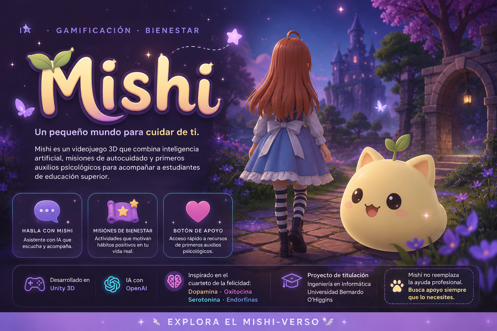

 🌙 Mishi 🌱

Un pequeño mundo para cuidar de ti

Una aventura donde la tecnología se encuentra con el autocuidado.

 Un videojuego 3D que integra inteligencia artificial, misiones de autocuidado y recursos de apoyo, con foco en el bienestar de estudiantes de educación superior.

 

 
 

 
 

---

💛 El corazón de Mishi

Mishi nace como una propuesta tecnológica que busca acercar experiencias de autocuidado y recursos de apoyo a estudiantes de educación superior, a través de un entorno interactivo y amigable.

<table>
  <tr>
    <td width="33%" align="center" valign="top">💬

Conversación con IA

Interacción conversacional dentro del videojuego mediante inteligencia artificial.

</td>
<td width="33%" align="center" valign="top">

🌿

Misiones de autocuidado

Actividades gamificadas que invitan a dedicar tiempo al bienestar personal.

</td>
<td width="33%" align="center" valign="top">

💗

Recurso de apoyo

Un recurso audiovisual relacionado con los primeros auxilios psicológicos.

</td>

  </tr>
</table>---

✨ Explora el Mishi-verso

Un vistazo a las ideas, el diseño y el desarrollo detrás de Mishi.

 

 

 

 

---

🎓 Sobre el proyecto

Proyecto de titulación de Ingeniería en Informática
Universidad Bernardo O’Higgins (UBO).

Mishi es un prototipo académico orientado al bienestar estudiantil. Su desarrollo explora cómo una experiencia interactiva puede integrar inteligencia artificial, actividades de autocuidado y recursos informativos en un entorno virtual.

 «💗 Importante

Mishi no reemplaza la atención de profesionales de la salud mental ni constituye una herramienta de diagnóstico o tratamiento. El prototipo no demuestra eficacia clínica.»

---

 🌙 Gracias por visitar el Mishi-verso

Pequeñas aventuras, grandes intenciones. 🌱

 Hecho con 💜 por Kaled San Martin

Proyecto académico · Ingeniería en Informática · UBO

 

