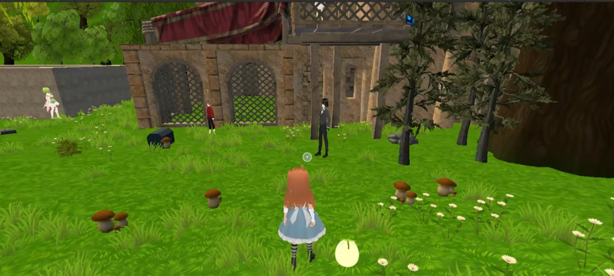
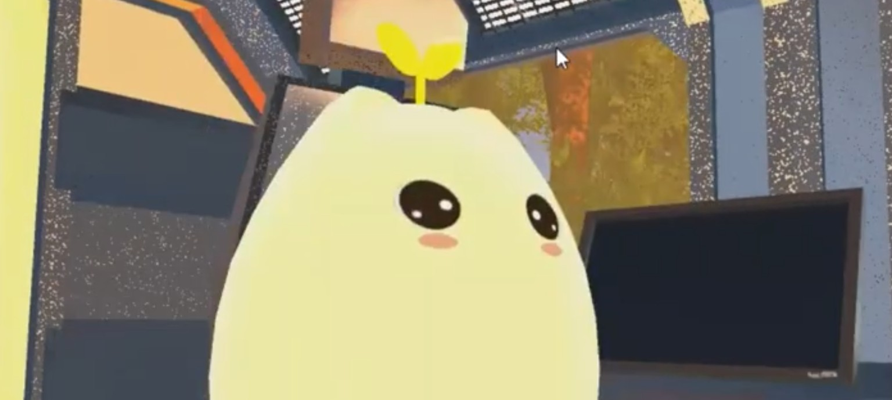
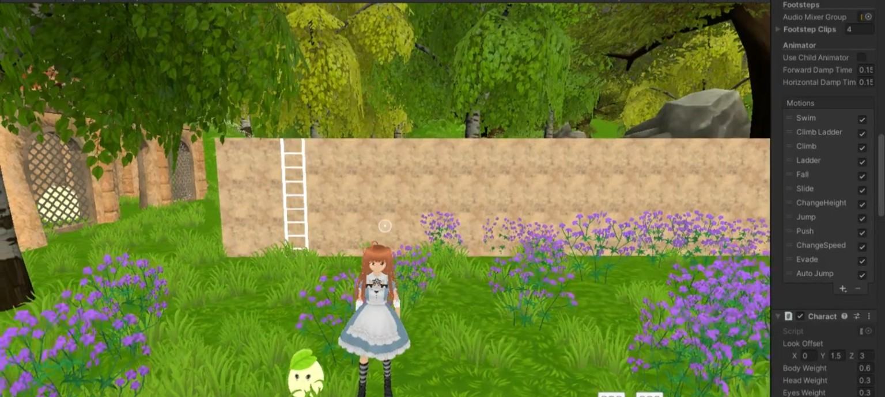

 

☾ &nbsp; UN UNIVERSO PEQUEÑO, UN PROPÓSITO ENORME &nbsp; ☽

# Mishi ✦

### Pequeños pasos. Un poquito de magia.

*Un pequeño mundo para cuidar de ti.*

 

&nbsp;

  

---

*Hay aventuras que comienzan explorando un mundo.*  
*Otras comienzan aprendiendo a cuidar de uno mismo.*

 

Mishi es una experiencia interactiva en 3D que reúne **inteligencia artificial, misiones de autocuidado y recursos de apoyo** para acercar el bienestar a estudiantes de educación superior.

Una propuesta donde la tecnología se encuentra con la imaginación y donde hacer una pausa también puede formar parte de la aventura.

 

<table>
<tr>
<td width="55%" valign="top">

## 01 &nbsp; ✧ Hablar

### Una conversación que cobra vida

La inteligencia artificial permite una interacción conversacional dentro del videojuego, haciendo de la experiencia un espacio más dinámico y cercano.

</td>
<td width="45%" valign="middle" align="center">

### 💬

UN MOMENTO PARA CONECTAR

</td>
</tr>
<tr>
<td width="45%" valign="middle" align="center">

### 🌿

UN MOMENTO PARA TI

</td>
<td width="55%" valign="top">

## 02 &nbsp; ✧ Explorar

### Pequeños pasos de autocuidado

Misiones gamificadas que invitan a dedicar tiempo al bienestar personal y a descubrir actividades a través de la exploración.

</td>
</tr>
<tr>
<td width="55%" valign="top">

## 03 &nbsp; ✧ Descubrir

### Recursos que acompañan

Un recurso audiovisual relacionado con los primeros auxilios psicológicos forma parte de la propuesta de apoyo de Mishi.

</td>
<td width="45%" valign="middle" align="center">

### 💗

UN MOMENTO PARA APRENDER

</td>
</tr>
</table>

---

# ✦ El Mishi-verso ✦

*Un espacio para explorar y cuidarte.*

 

 

UN MUNDO VIRTUAL · UNA EXPERIENCIA INTERACTIVA

 

<table>
<tr>
<td width="50%" valign="top">

**Mishi & Alicia**

Personajes y compañía en esta aventura.

</td>
<td width="50%" valign="top">

**Detrás de escena**

El proceso de construir un mundo en 3D.

</td>
</tr>
</table>

---

## ☄️ Los ingredientes de esta aventura

HERRAMIENTAS · DISEÑO · DESARROLLO

  

 

 

---

## ✧ Pequeñas ventanas a nuestro universo

Hay cosas que se cuentan mejor cuando puedes verlas.

<table>
<tr>
<td width="50%" valign="top">

**01 / El mundo antes de abrirse**

Diseño y concepto visual.

</td>
<td width="50%" valign="top">

**02 / La aventura en movimiento**

Demostraciones del videojuego.

</td>
</tr>
<tr>
<td width="50%" valign="top">

**03 / Una aventura con propósito**

Conoce AUF.

</td>
<td width="50%" valign="top">

**04 / Una pausa para jugar**

Juego de memoria.

</td>
</tr>
</table>

---

<b>✦ La historia detrás de la magia</b>

 

Mishi es un **proyecto de titulación de Ingeniería en Informática** de la Universidad Bernardo O’Higgins (UBO).

Nace como una propuesta tecnológica orientada al bienestar de estudiantes de educación superior. Explora cómo la inteligencia artificial, las actividades de autocuidado y los recursos informativos pueden integrarse en una experiencia interactiva dentro de un entorno virtual.

Es un prototipo académico que busca explorar nuevas formas de acercar la tecnología a experiencias de bienestar.

 

**Una nota importante**

Mishi no reemplaza la atención de profesionales de la salud mental ni es una herramienta de diagnóstico o tratamiento. El prototipo no demuestra eficacia clínica.

---

### ☾ Todo gran universo comienza con una pequeña idea. ✧

 

*Gracias por visitar el Mishi-verso.*

**Pequeñas aventuras, grandes intenciones.** 🌱

 

Hecho con 💜 por **Kaled San Martin**

PROYECTO ACADÉMICO · INGENIERÍA EN INFORMÁTICA · UBO

 

