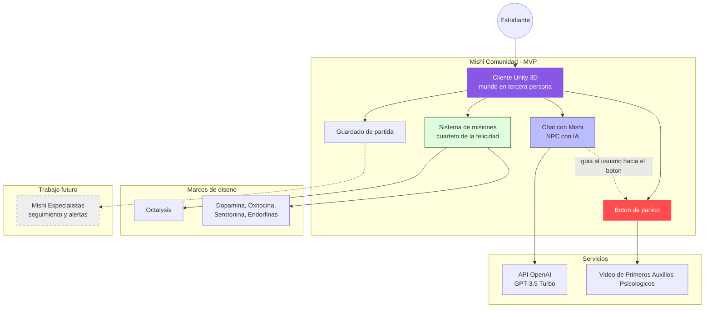

# 🐾 Mishi: IA y Gamificación para el Bienestar Mental Universitario

  
  
  
  

> **Memoria para optar al título de Ingeniero en Informática**: *Aplicación basada en IA para disminuir el deterioro de la salud mental en estudiantes de educación superior*.
> Universidad Bernardo O'Higgins (UBO), Santiago de Chile · Autora: **Kaled Ariadna San Martin Lastra** · Profesor guía: José Miguel Rubio León

---

## 📖 Resumen Ejecutivo

**Mishi** es un videojuego-aplicación en tercera persona que acompaña a estudiantes de educación superior en la gestión del estrés y la ansiedad. Combina tres ideas:

1. **Un asistente virtual con IA** (API de OpenAI) que conversa con el usuario para escucharlo y distraerlo, integrado como NPC dentro de un mundo de fantasía.
2. **Misiones narradas de forma épica** que invitan a hacer cosas en el mundo real para estimular de forma natural el "cuarteto de la felicidad": **dopamina, oxitocina, serotonina y endorfinas**.
3. **Un botón de pánico** que da acceso a una guía de **Primeros Auxilios Psicológicos (PAP)** para episodios de crisis.

> ⚠️ **Mishi no es una terapia ni reemplaza a un profesional de salud mental.** Su propósito es ser un punto de acercamiento que anima a buscar ayuda especializada.

---

## 🎯 El problema

Los datos con los que se justificó el proyecto (detalle y fuentes en la memoria):

| Dato | Fuente citada en la tesis |
| --- | --- |
| Las consultas por salud mental pasaron de **55,7 % (2018)** a **77,9 % (2022)** de las consultas estudiantiles totales | Subsecretaría de Educación Superior |
| **50 %** de las instituciones de educación superior no tiene convenios para derivar estudiantes con problemas de salud mental | Subsecretaría de Educación Superior |
| Más del **45 %** de universitarios chilenos presentó síntomas de riesgo de depresión, ansiedad o estrés; **5 %** reportó ideación suicida | Barrera y Martín (2021) |
| **69,2 %** con síntomas depresivos moderados a severos y **60,5 %** con ansiedad moderada a severa durante la pandemia (Región de Valparaíso) | Estudio regional sobre salud mental en pandemia |

**Hipótesis del proyecto:** una aplicación que combine gamificación, primeros auxilios psicológicos e interacción con un asistente de IA puede mejorar la experiencia estudiantil y el bienestar mental.

---

## 🔗 Evidencia y Documentación

  
  &nbsp;&nbsp;
  
  &nbsp;&nbsp;
  
  &nbsp;&nbsp;
  

### 🎬 Mishi en acción

Cada video documenta una etapa o funcionalidad del proyecto. Haz clic en la miniatura para verlo.

**🧪 De la idea al prototipo**

<table>
  <tr>
    <td align="center" width="33%">
       
      <b>Mishi en el 2100</b> Pitch de visión
    </td>
    <td align="center" width="33%">
       
      <b>Mishi Pitch</b> Elevator pitch del proyecto
    </td>
    <td align="center" width="33%">
       
      <b>Validación de concepto (UBO Inicia)</b> 5° Concurso de Emprendimiento e Innovación UBO
    </td>
  </tr>
  <tr>
    <td align="center" width="33%">
       
      <b>Mishi v1.0: MVP en WordPress</b> Validación funcional temprana
    </td>
    <td></td>
    <td></td>
  </tr>
</table>

**🎮 El prototipo en Unity 3D**

<table>
  <tr>
    <td align="center" width="33%">
       
      <b>Entorno inmersivo</b> Movimiento, avatar y NPCs
    </td>
    <td align="center" width="33%">
       
      <b>Interfaz de chat temprana</b> Primer test de UI en 3D
    </td>
    <td align="center" width="33%">
       
      <b>Integración OpenAI</b> Test de NLP y personalidad de Mishi
    </td>
  </tr>
  <tr>
    <td align="center" width="33%">
       
      <b>Sistema de quests</b> Mecánicas de gamificación
    </td>
    <td align="center" width="33%">
       
      <b>Botón de pánico</b> Protocolo de emergencia
    </td>
    <td align="center" width="33%">
       
      <b>Primeros Auxilios Psicológicos</b> La guía que activa el botón
    </td>
  </tr>
</table>

📌 También: [*60 secondes pour convaincre*, finalistas 2ª edición (AUF, 2022)](https://www.youtube.com/watch?v=8aOUeTWVn2Y).

---

## ⚙️ Arquitectura Funcional

Arquitectura del MVP (ejecución local) y la evolución prevista del "Mishi-verso":

---

## 🔍 Inmersión en las Funcionalidades

<b>🧠 Mishi, el asistente con IA</b>

 

El chat con Mishi usa la **API de OpenAI (GPT-3.5 Turbo)** integrada en Unity y está pensado para **escuchar, entender y distraer** al usuario con distracción positiva y apoyo emocional.

* **Ingeniería de prompts y personalidad:** Mishi rompe el hielo con humor y recomienda contenido cultural (por ejemplo, música) para mejorar el estado de ánimo. La idea es que sea un puente cercano, no un chatbot convencional.
* **Del chat al NPC:** en las validaciones se observó que **un chatbot "a secas" no resultaba amigable**, por lo que el asistente se integró como **NPC en un mundo de fantasía en tercera persona**.
* **Evolución técnica:** primero se probó la interfaz de chat en el entorno 3D y luego se integró la API de OpenAI (ver videos arriba).

▶️ [Interfaz de chat](https://youtu.be/JL9prLLMgMA) · [Integración OpenAI](https://youtu.be/pIdHgLZ9bTw)

<b>🏆 Gamificación con Octalysis y el "Cuarteto de la Felicidad"</b>

 

Inspirado en *Habits of a Happy Brain* (Loretta G. Breuning), las misiones apuntan a estimular de forma natural cuatro químicos del bienestar:

| Químico | Se asocia con |
| --- | --- |
| **Dopamina** | Lograr metas y celebrar logros |
| **Serotonina** | Estar al aire libre, meditar, hacer ejercicio |
| **Endorfinas** | Ejercicio, reír, compartir con seres queridos |
| **Oxitocina** | Abrazar, agradecer, recibir cumplidos |

La capa de juego se diseñó con el **framework Octalysis** (Yu-kai Chou): misiones narradas de forma épica, exploración, inventario, tienda con NPC, recolección y crafteo. El sistema de quests está desarrollado en **C#** con seguimiento de tareas en tiempo real y retroalimentación visual al completar hitos de autocuidado.

Según la memoria, **antes de gamificar, la propuesta era poco atractiva y los usuarios podían "falsear" que hacían las misiones**; tras iterar con especialistas y público objetivo se registró **interés genuino** y comentarios de que sería interesante escalarlo.

**Filosofía:** Mishi no busca retener al usuario en pantalla. Las misiones lo invitan a salir a hacer actividades reales, y el sistema de recompensas contempla a futuro premios reales vía alianzas.

▶️ [Sistema de quests](https://youtu.be/1hSqgYML_ww)

<b>🚨 Botón de pánico y Primeros Auxilios Psicológicos</b>

 

Acceso rápido a una guía de PAP basada en la **reactivación de los sentidos**. El diseño original (Figma, RF05) define un ciclo guiado por audio:

* Respiración triangular (3 s inhalar, 3 s sostener, 3 s exhalar).
* Anclaje al presente: mirar alrededor, tomar un objeto, sentir una textura, identificar un aroma, pensar en un sabor, nombrar una emoción.
* El ciclo se repite hasta que el usuario indica que se siente mejor.

En el MVP implementado, el botón **reproduce un video de primeros auxilios psicológicos**. Además, gracias a la integración con OpenAI, **el asistente conoce la ubicación del botón en la interfaz (inferior izquierda) y puede guiar verbalmente al usuario hacia él**, pensado para momentos de alta carga emocional. El flujo busca reducir al mínimo los pasos para llegar al recurso de ayuda.

▶️ [Test del botón de pánico](https://youtu.be/qPd3npeGM_A) · [Video de Primeros Auxilios Psicológicos](https://youtu.be/zg57-NAUB-Q)

<b>🎮 Entorno 3D y stack técnico</b>

 

| Componente | Tecnología |
| --- | --- |
| Motor | **Unity 3D** con **C#** |
| IA conversacional | **API de OpenAI** (GPT-3.5 Turbo) |
| Locomoción, inventario y misiones | Assets de **Devion Games** (caminar, correr, nadar, escalar, saltar) |
| Personajes | **VRoid Studio** + librería **UniVRM** (incluida Alice, la protagonista) |
| Identidad visual de Mishi | Asset *Kawaii Slimes* |
| Prototipos previos | Figma, WordPress, maqueta de bajo nivel (lápices y goma eva) |
| Gestión | Trello (Kanban), PMBOK, Lean + Agile |
| Persistencia local | XAMPP + MySQL |

▶️ [Entorno inmersivo y control de movimiento](https://youtu.be/1T1iKlbJVDI)

<b>🧪 Cómo se construyó: Design Thinking + Lean/Agile</b>

 

* **Empatizar:** encuesta a 10 estudiantes de Ingeniería en Informática UBO → buyer persona.
* **Definir:** diagrama causa-efecto y canvas de propuesta de valor.
* **Idear:** brainstorming, sombreros para pensar, FODA y modelo de negocio Canvas.
* **Prototipar:** maqueta Figma, prototipo de bajo nivel, storyboard, **MVP en WordPress** ([video](https://youtu.be/_cfLRPfI7u8)) y póster científico.
* **Testear:** iteración con una psicóloga y en distintas instancias de presentación, incluida la prueba de concepto en UBO Inicia ([video](https://youtu.be/fpMdAi5Nn0o)). Se descartaron los tests psicológicos validados en Chile (poco atractivos, costosos y con riesgo legal) y se reemplazó el chatbot simple por un NPC inmersivo. El feedback del prototipo web impulsó el salto a Unity 3D.
* **Gestión:** enfoque combinado Lean + Agile con tablero Kanban en Trello (se descartó Scrum por su rigidez), guiado por PMBOK.

<b>🛡️ Ingeniería, Estándares y Ética</b>

 

* **IEEE 830:** especificación de requisitos (7 requisitos funcionales y requisitos no funcionales de rendimiento, seguridad, fiabilidad, disponibilidad, mantenibilidad, portabilidad, usabilidad y ético-legal).
* **Arquitectura documentada:** diagramas **C4** (contexto, contenedores, componentes) y **UML** (casos de uso, secuencia, robustez y clases).
* **Protección de datos:** el diseño considera el **RGPD** (consentimiento y condiciones de uso) y buenas prácticas tipo **ISO 27001**. El MVP corre de forma local, sin cuentas de usuario.
* **Gestión de riesgos:** matriz gravedad × probabilidad. La dependencia de OpenAI se mitiga con una alternativa (Rasa) y la de assets, con reemplazos.

<b>✅ Validación del MVP</b>

 

* Plan de pruebas con checklist que cubre **chat, misiones, botón de pánico, movimiento y guardado**.
* **Las pruebas se grabaron en video** como evidencia de trazabilidad y hoy viven en la [playlist de YouTube](https://youtube.com/playlist?list=PL6ic-uQzzKmJ8V9HsY_NsBZbLNKJDE59_).
* Pruebas con un segundo tester (alpha tester) que probó sin instrucciones previas para medir la intuitividad; sus hallazgos llevaron a reconfigurar los controles.
* Validación cualitativa en terreno durante **UBO Inicia 2022 (Espacio Blanco)** y en la defensa de póster de la Semana de la Ingeniería UBO 2022.

---

## 🗺️ Trabajo futuro

* **Multiusuario** y cuentas (registro, inicio de sesión, recuperación de contraseña).
* **Mishi Especialistas:** vinculación con profesionales de confianza, seguimiento por paciente y alertas de riesgo para agilizar listas de espera.
* Interacción **por voz** y análisis de sentimiento.
* Portabilidad a **Android** y evaluación de alternativas a OpenAI y a los assets de terceros.
* Estudios de impacto con mediciones formales (escalas validadas, muestra mayor).

---

## 🏛️ Reconocimientos

* **🌍 Finalista, 2ª edición del concurso *60 secondes pour convaincre*** (Agence Universitaire de la Francophonie).
* **🔬 2º lugar**, defensa de póster, Semana de la Ingeniería UBO 2022.
* **🚀 UBO Inicia 2022:** prueba de concepto y validación en terreno (Espacio Blanco).
* **🥇 1er lugar NTT DATA & UBO** · **🎤 2º lugar Festival del Pitch**

---

> [!IMPORTANT]
> **Aviso técnico:** este repositorio es una vitrina de arquitectura y diseño. El código fuente y los binarios se mantienen en reserva por propiedad intelectual y conforme a la memoria de título.

Desarrollado con 💜 por <a href="https://www.youtube.com/@KaledSML">Kaled San Martin</a>

